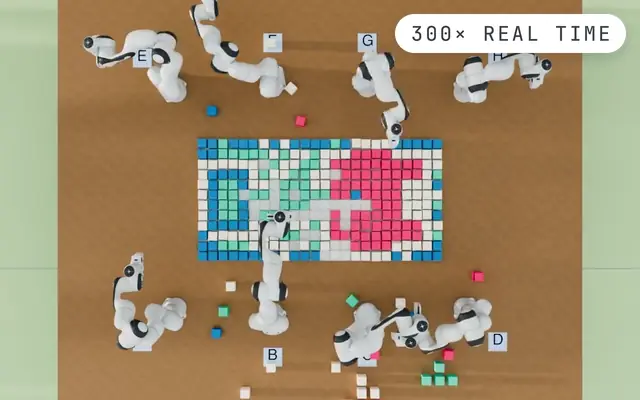
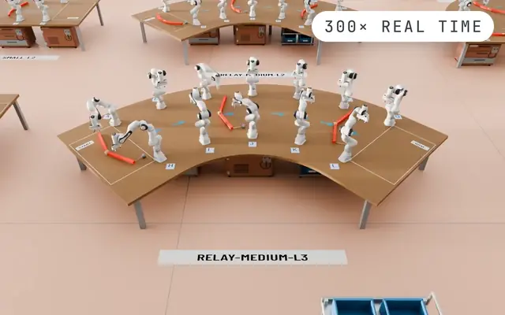
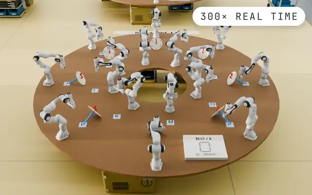
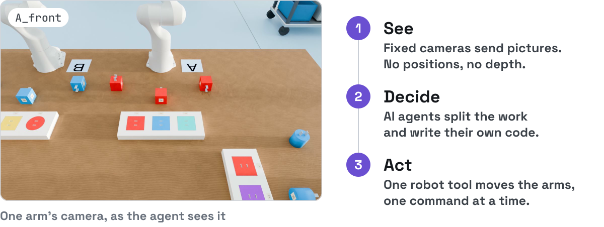
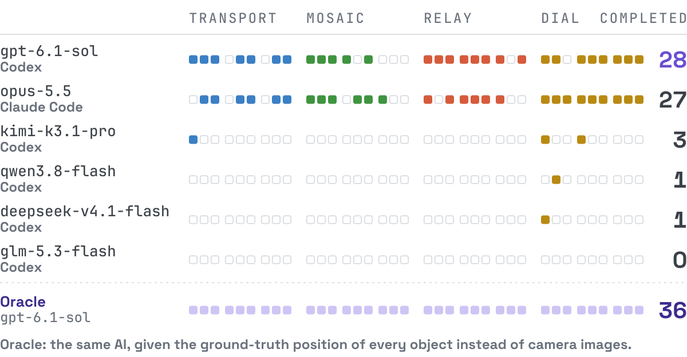

<div align="center">

<h1>
<a href="https://changxuanfan.github.io/RoboTeam/">
<picture>
<source media="(prefers-color-scheme: dark)" srcset="docs/media/readme/wordmark-dark.svg">

</picture>
</a>
</h1>

<h3>RoboTeam: Benchmarking Vision-Based Multi-Agent Control<br>of Many Robot Arms in Real Time</h3>

<p><i>Teams of AI agents run a factory hall of robot arms, in real time, from camera images alone.</i></p>

<a href="https://arxiv.org/abs/2611.22138"><picture><source media="(prefers-color-scheme: dark)" srcset="docs/media/readme/button-paper-dark.svg"></picture></a>&nbsp;
<a href="https://changxuanfan.github.io/RoboTeam/"><picture><source media="(prefers-color-scheme: dark)" srcset="docs/media/readme/button-page-dark.svg"></picture></a>&nbsp;
<a href="https://huggingface.co/datasets/RoboTeam-Bench/RoboTeam-Videos"><picture><source media="(prefers-color-scheme: dark)" srcset="docs/media/readme/button-videos-dark.svg"></picture></a>&nbsp;
<a href="#license"><picture><source media="(prefers-color-scheme: dark)" srcset="docs/media/readme/button-license-dark.svg"></picture></a>

English | [简体中文](README.zh-CN.md)

[Jobs](#the-four-jobs) · [Watch](#watch-whole-runs) · [How it works](#how-a-run-works) · [Findings](#what-we-found) · [Quick start](#quick-start) · [Docs](docs/README.md)

<picture>
<source media="(prefers-reduced-motion: reduce)" srcset="docs/media/readme/hero.webp">
<source type="image/avif" srcset="docs/media/readme/hero.avif">

</picture>

<picture>
<source media="(max-width: 600px) and (prefers-color-scheme: dark)" srcset="docs/media/readme/numbers-phone-dark.svg">
<source media="(max-width: 600px)" srcset="docs/media/readme/numbers-phone-light.svg">
<source media="(prefers-color-scheme: dark)" srcset="docs/media/readme/numbers-dark.svg">

</picture>

</div>

## What RoboTeam is

RoboTeam is a simulated factory hall in which teams of AI agents run 4 to 16 robot arms, seeing
only through cameras. It has four jobs, the kinds of work, and 36 tasks: each job with three team
sizes at three levels. It measures how many tasks a team completes, how long that takes, and its
input tokens, the text a model reads, which sets the cost.

## The four jobs

<table><tr>
<td width="50%" valign="top"><a href="https://changxuanfan.github.io/RoboTeam/#task=transport-large-l3&amp;set=gpt-6.1-sol"></a><br><b>Transport</b><br>Deliver every item to its board, passing it from arm to arm.<br><sub>4–12 arms · flat → sockets → sprung</sub></td>
<td width="50%" valign="top"><a href="https://changxuanfan.github.io/RoboTeam/#task=mosaic-large-l1&amp;set=opus-5.5"></a><br><b>Mosaic</b><br>Build a picture from colored cubes, one in every cell.<br><sub>4–8 arms · pockets → lines → no grid</sub></td>
</tr></table>
<table><tr>
<td width="50%" valign="top"><a href="https://changxuanfan.github.io/RoboTeam/#task=relay-medium-l3&amp;set=gpt-6.1-sol"></a><br><b>Relay</b><br>Carry long timbers that need two arms and change hands in the air.<br><sub>8–16 arms · straight → curved → hinged</sub></td>
<td width="50%" valign="top"><a href="https://changxuanfan.github.io/RoboTeam/#task=dial-large-l3&amp;set=gpt-6.1-sol"></a><br><b>Dial</b><br>Turn spring-loaded knobs to find a hidden code, and hold them all.<br><sub>4–16 arms · table → lifted → crank</sub></td>
</tr></table>

Each clip opens its whole run on the project page. The [task guide](docs/tasks/README.md) shows
all 36 tasks.

## Watch whole runs

Whole runs at 10× real time, with idle stretches cut. The
[project page](https://changxuanfan.github.io/RoboTeam/#videos) has the runs of every model,
from three cameras.

<table><tr>
<td width="50%" valign="top"><video src="https://github.com/user-attachments/assets/85ab5c04-a60b-4e3f-b364-105a6b39f723" controls muted width="100%"></video><!-- video:transport-1 --><br><sub><b>Transport</b> · opus-5.5 · 12 arms, items set into sockets · 10×, 11:20</sub></td>
<td width="50%" valign="top"><video src="https://github.com/user-attachments/assets/804f16ac-984b-4a7b-98ef-41f686ad29ca" controls muted width="100%"></video><!-- video:mosaic-1 --><br><sub><b>Mosaic</b> · opus-5.5 · 6 arms, 162 cubes, no grid on the table · 10×, 8:56</sub></td>
</tr></table>
<table><tr>
<td width="50%" valign="top"><video src="https://github.com/user-attachments/assets/de8afa7e-a1fb-46e8-9eb6-75f3715b8780" controls muted width="100%"></video><!-- video:relay-2 --><br><sub><b>Relay</b> · opus-5.5 · 12 arms, curved timbers with a hanging weight · 10×, 3:51</sub></td>
<td width="50%" valign="top"><video src="https://github.com/user-attachments/assets/b61e48bd-bd4d-4192-b86e-6c07c43f6ab8" controls muted width="100%"></video><!-- video:dial-1 --><br><sub><b>Dial</b> · gpt-6.1-sol · 16 arms, 8 cranks held in the air · 10×, 4:31</sub></td>
</tr></table>

<details>
<summary><b>Four more runs</b></summary>

&nbsp;

<table><tr>
<td width="50%" valign="top"><video src="https://github.com/user-attachments/assets/06263096-6cc7-4c47-96ba-8815f376f2f5" controls muted width="100%"></video><!-- video:transport-2 --><br><sub><b>Transport</b> · gpt-6.1-sol · 8 arms, items set into sockets · 10×, 9:02</sub></td>
<td width="50%" valign="top"><video src="https://github.com/user-attachments/assets/edf6dfaf-4797-4478-b983-82612114b3a5" controls muted width="100%"></video><!-- video:mosaic-2 --><br><sub><b>Mosaic</b> · gpt-6.1-sol · 4 arms, 72 cubes, no grid on the table · 10×, 5:55</sub></td>
</tr></table>
<table><tr>
<td width="50%" valign="top"><video src="https://github.com/user-attachments/assets/c3e1f49b-aec6-4eaa-abc4-3014f60ad030" controls muted width="100%"></video><!-- video:relay-1 --><br><sub><b>Relay</b> · gpt-6.1-sol · 16 arms, straight timbers · 10×, 2:14</sub></td>
<td width="50%" valign="top"><video src="https://github.com/user-attachments/assets/6b6cfcf8-25e7-4227-8b83-9539a6f82f1d" controls muted width="100%"></video><!-- video:dial-2 --><br><sub><b>Dial</b> · opus-5.5 · 12 arms, 6 cranks held in the air · 10×, 1:46</sub></td>
</tr></table>

</details>

Every file is in the [RoboTeam-Videos dataset](https://huggingface.co/datasets/RoboTeam-Bench/RoboTeam-Videos)
on Hugging Face, where a few runs are marked Coming soon.

## What is new

Earlier benchmarks test agents in a simpler world in three ways. RoboTeam removes all three:

- **Many arms, long tasks.** Most use one or two arms on tasks of minutes. RoboTeam puts 4 to 16
  arms on one task, modeled on real multi-robot work, and a run may last up to 24 hours.
- **A world that never pauses.** Many simulators stop while the agent thinks. In RoboTeam the
  clock keeps running, so slow thinking costs working time.
- **Cameras only.** Many tell the agent where every object is. In RoboTeam, as on a real robot,
  the agents must find out from what they see.

<p align="center"><b>Only RoboTeam has 16 arms and runs of up to 24 hours.</b><br><sub>Ten other benchmarks, from the paper's comparison table</sub></p>

<p align="center"><a href="https://changxuanfan.github.io/RoboTeam/#new">
<picture>
<source media="(prefers-color-scheme: dark)" srcset="docs/media/readme/compare-dark.svg">

</picture>
</a></p>

## How a run works

<a href="https://changxuanfan.github.io/RoboTeam/#how">
<picture>
<source media="(prefers-color-scheme: dark)" srcset="docs/media/readme/how-dark.svg">

</picture>
</a>

The clock never stops: a run ends when the agents say they are done, or after 24 hours. A team
runs one of four agent systems: single-agent, hierarchical, decentralized or adaptive (the
default). The
[rules of a run](docs/benchmark/rules.md#a-run-in-six-steps) give the details.

## What we found

gpt-6.1-sol completes 28 of the 36 tasks and opus-5.5 completes 27; the four other models
complete at most 3. In the Oracle condition, the same gpt-6.1-sol gets the ground-truth position
of every object instead of camera images, and completes all 36.

### 1 · Two models complete most of the 36 tasks

<sub>One square per task, filled when completed. From camera images alone.</sub>

<p align="center"><a href="https://changxuanfan.github.io/RoboTeam/#results">
<picture>
<source media="(prefers-color-scheme: dark)" srcset="docs/media/readme/board-dark.svg">

</picture>
</a></p>

### 2 · Seeing is the hard part

From camera images, 23% of gpt-6.1-sol's grasps fail, against 0.3% when it is given every
position. With pictures of only 128 × 80 pixels, or without its own code to measure them, it
completes 14 or 13 tasks instead of 28.

<p align="center"><a href="https://changxuanfan.github.io/RoboTeam/#f-vision">
<picture>
<source media="(prefers-color-scheme: dark)" srcset="docs/media/readme/vision-dark.svg">

</picture>
</a></p>

### 3 · Same score, very different bill

The four agent systems of gpt-6.1-sol complete 27 to 29 tasks, but over all 36 tasks the
hierarchical system uses 3× the input tokens of the single-agent system, and the single-agent
system takes 2× the time of the decentralized system. Hours and input tokens are totals over all
36 tasks.

<p align="center"><a href="https://changxuanfan.github.io/RoboTeam/#f-systems">
<picture>
<source media="(prefers-color-scheme: dark)" srcset="docs/media/readme/systems-dark.svg">

</picture>
</a></p>

### More findings

Each with its chart on the project page:

- [The arms mostly wait.](https://changxuanfan.github.io/RoboTeam/#f-time) In one recorded run,
  at least one agent is thinking 90% of the time, but at least one arm moves only 43% of it.
- [Failing and trying again is normal.](https://changxuanfan.github.io/RoboTeam/#f-failure)
  In a typical Relay task of gpt-6.1-sol, every step fails at least once, yet it completes 8 of
  the 9 Relay tasks.
- [A bigger team is harder than a harder level.](https://changxuanfan.github.io/RoboTeam/#f-levels)
  By level, gpt-6.1-sol completes 9, 9 and 10 of 12 tasks; by team size, 11, 10 and 7.

Spending more does not buy success: deepseek-v4.1-flash used 25.0 billion input tokens and
completed 1 task, while gpt-6.1-sol used 27.0 billion and completed 28. No model or agent system is yet
fast, cheap and reliable at once. Every chart, with each run to open, is in the
[project page's results](https://changxuanfan.github.io/RoboTeam/#results), and every condition
and number in the [paper](https://arxiv.org/abs/2611.22138).

## Quick start

```sh
git clone https://github.com/changxuanfan/RoboTeam.git && cd RoboTeam
uv sync --locked                                   # Python 3.12 and the locked packages
.venv/bin/roboteam bootstrap                       # the task assets, checked by hash
.venv/bin/roboteam plan --task-types relay --level 1
```

`plan` lists the tasks a batch would run and calls no model, so it is a safe first command. A
real run also needs an account for a model, the pinned Codex or Claude Code command-line program,
and a sandboxed Python environment for the agents.
[Getting started](docs/getting-started.md) goes from a fresh clone to a complete run.

## Documentation

- [Getting started](docs/getting-started.md) and the [command line](docs/cli.md)
- [The tasks](docs/tasks/README.md) and the [rules of a run](docs/benchmark/rules.md)
- [Harnesses and models](docs/harness/README.md): Codex, Claude Code and the models each can run
- Hosts: [Mac](docs/hosts/mac.md), [Linux](docs/hosts/linux.md), [Docker](docs/hosts/docker.md)
  and [Slurm](docs/hosts/slurm.md)
- [Repository layout](docs/development/repository-layout.md): what each folder holds
- [Every guide](docs/README.md) and the [contribution guide](.github/CONTRIBUTING.md)

## Citation

```bibtex
@article{fan2026roboteam,
  title   = {RoboTeam: Benchmarking Vision-Based Multi-Agent Control of
             Many Robot Arms in Real Time},
  author  = {Fan, Changxuan and Xie, Zhongwei and Zhang, Boyi and Hu, Shaoli and
             Xu, Chang and Ren, Xiyu and Li, Yufei and Xiao, Qiao and Jing, Huihao and
             Chung, Kawai and Hu, Wenbin and Luo, Hongyu and Xie, Lingyun and
             Gao, Yisen and Li, Chunyang and Huang, Haoyu and Song, Wuganjing and
             Liu, Yuxuan and Tang, Chiu Yeung and Zhan, Fangneng and Yang, Xi},
  journal = {arXiv preprint arXiv:2611.22138},
  year    = {2026},
  url     = {https://arxiv.org/abs/2611.22138}
}
```

[`CITATION.cff`](CITATION.cff) has the same record.

## License

Code is under the [MIT License](LICENSE). Benchmark data and media are under
[CC BY 4.0](LICENSE-DATA.md), which also lists the third-party material that keeps its own
license.
