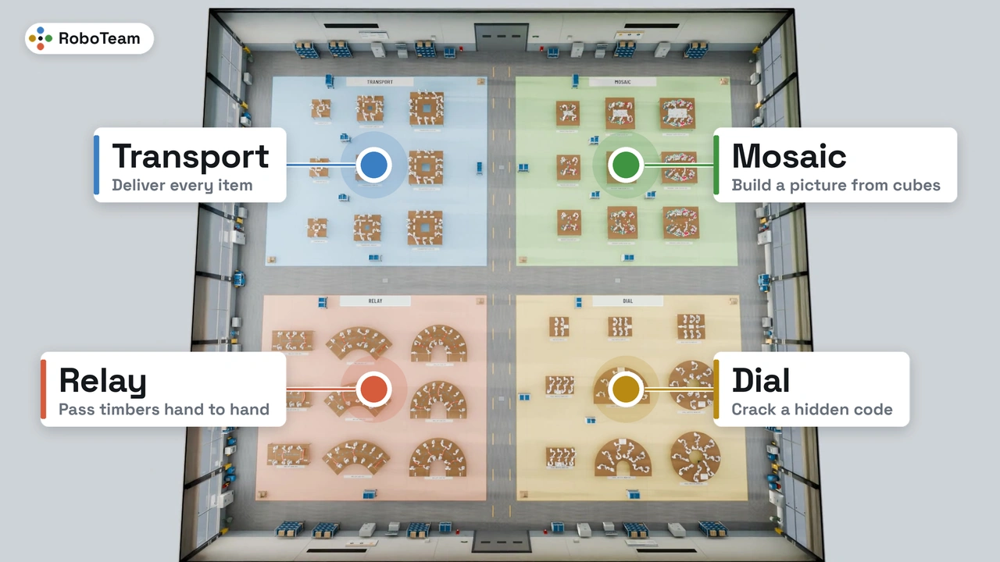
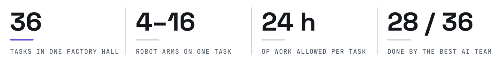
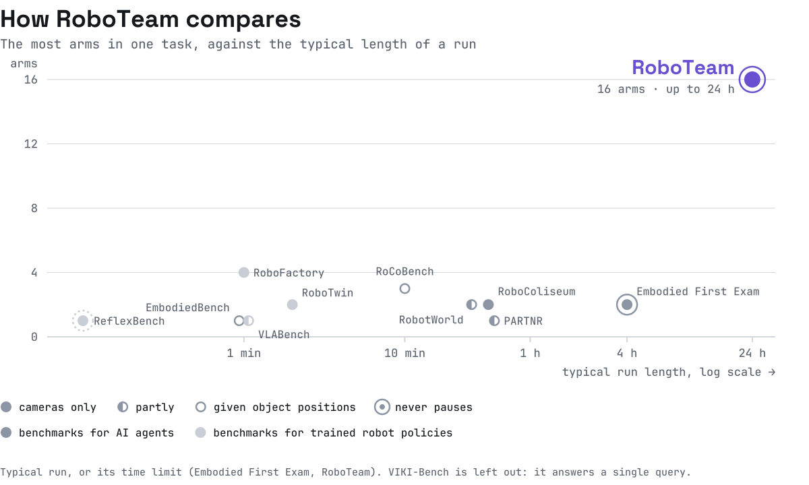
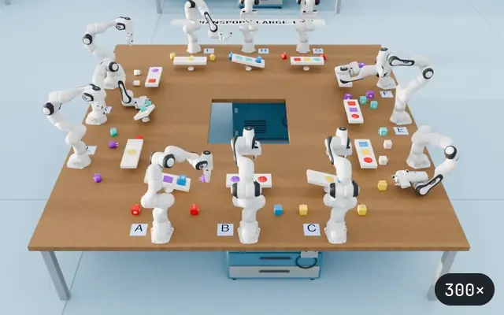
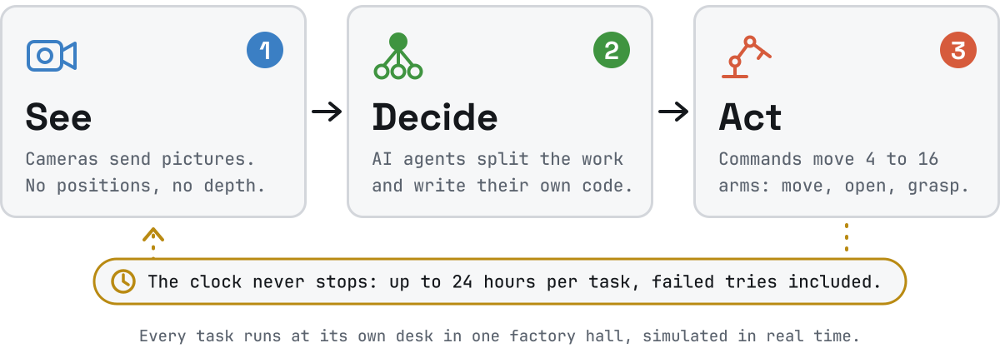
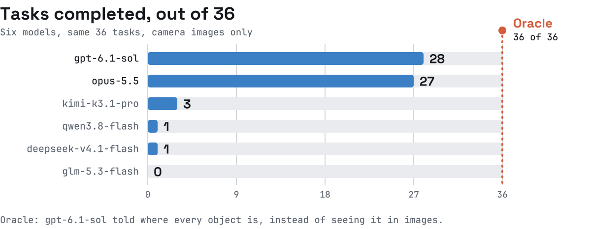
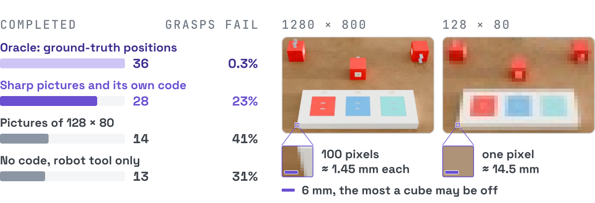
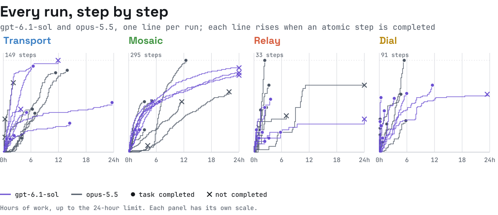
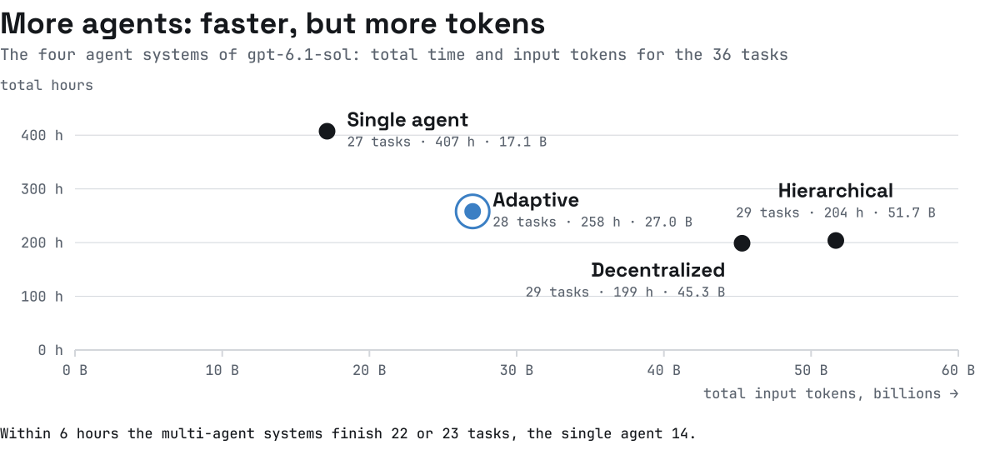

<div align="center">

<h1>
<a href="https://changxuanfan.github.io/RoboTeam/">
<picture>
<source media="(prefers-color-scheme: dark)" srcset="docs/media/readme/wordmark-dark.svg">

</picture>
</a>
</h1>

**Teams of AI agents run a factory hall of robot arms, in real time, from camera images alone.**

<a href="https://arxiv.org/abs/2611.22138"><picture><source media="(prefers-color-scheme: dark)" srcset="docs/media/readme/button-paper-dark.svg"></picture></a>&nbsp;
<a href="https://changxuanfan.github.io/RoboTeam/"><picture><source media="(prefers-color-scheme: dark)" srcset="docs/media/readme/button-page-dark.svg"></picture></a>&nbsp;
<a href="https://huggingface.co/datasets/RoboTeam-Bench/RoboTeam-Videos"><picture><source media="(prefers-color-scheme: dark)" srcset="docs/media/readme/button-videos-dark.svg"></picture></a>&nbsp;
<a href="#license"><picture><source media="(prefers-color-scheme: dark)" srcset="docs/media/readme/button-license-dark.svg"></picture></a>

[What is new](#what-is-new) · [The four jobs](#the-four-jobs) · [How a run works](#how-a-run-works) · [What we found](#what-we-found) · [Watch](#watch-whole-runs) · [Quick start](#quick-start) · [Docs](docs/README.md)

<picture>
<source type="image/avif" srcset="docs/media/readme/hero.avif">

</picture>

<picture>
<source media="(prefers-color-scheme: dark)" srcset="docs/media/readme/numbers-dark.svg">

</picture>

</div>

## What RoboTeam is

RoboTeam is a simulated factory hall with 36 long jobs that robot arms can only do together:
sorting parts onto boards, building a picture from hundreds of cubes, passing timbers down a
line of arms, and cracking a code by turning cranks.

The workers are language models. Nobody tells them where anything is. They look at camera
pictures, decide what to do, and send simple commands to the arms, and the world keeps moving
while they think. RoboTeam measures how many of the jobs they finish, how long it takes them and
what it costs.

## What is new

<a href="https://changxuanfan.github.io/RoboTeam/#new">
<picture>
<source media="(prefers-color-scheme: dark)" srcset="docs/media/readme/compare-dark.svg">

</picture>
</a>

Agents can already control a robot arm or two through tools and code. Earlier benchmarks test
this in a simpler world, in three ways. RoboTeam removes all three at once:

- **Many arms, long jobs.** Most benchmarks use one or two arms on tasks of minutes. RoboTeam
  has 4 to 16 arms on one job, and a run may last up to 24 hours.
- **A world that never pauses.** Many simulators stop while the agent thinks, which a real robot
  cannot do. In RoboTeam the clock keeps running, so slow thinking costs working time.
- **Cameras only.** Many benchmarks tell the agent where every object is. A real robot must find
  out from its sensors, and so must agents in RoboTeam.

The jobs are modeled on real multi-robot work: sharing parts in an assembly cell, laying bricks,
carrying long parts, and turning valves.

## The four jobs

<table>
<tr>
<td width="50%" valign="top"><br><b>Transport</b><br>Deliver every item to its place on the right board. Any arm may carry any item, and items cross the table by being handed over or set down for the next arm.<br><sub><b>Arms</b> 4, 8, 12 &nbsp;·&nbsp; <b>Levels</b> flat targets → sockets → sockets on a sprung board</sub><br><sub>Shown: gpt-6.1-sol, 12 arms, 36 items</sub></td>
<td width="50%" valign="top"><br><b>Mosaic</b><br>Build a reference picture, one colored cube per cell. The picture has four colors, and every cell needs the right one.<br><sub><b>Arms</b> 4, 6, 8 &nbsp;·&nbsp; <b>Levels</b> pockets → printed lines → unmarked cells</sub><br><sub>Shown: opus-5.5, 8 arms, 288 cubes</sub></td>
</tr>
<tr>
<td width="50%" valign="top"><br><b>Relay</b><br>Carry long timbers to the goal. It takes at least two arms to carry one, and each timber must change hands in the air at least once.<br><sub><b>Arms</b> 8, 12, 16 &nbsp;·&nbsp; <b>Levels</b> straight → curved with a hanging weight → hinged with a hanging weight</sub><br><sub>Shown: gpt-6.1-sol, 12 arms, 3 hinged timbers</sub></td>
<td width="50%" valign="top"><br><b>Dial</b><br>Find a hidden code by turning spring-loaded knobs and holding them all at once. The only hint is a display of the best try so far.<br><sub><b>Arms</b> 4 to 16 &nbsp;·&nbsp; <b>Levels</b> knobs on the table → modules held in the air → cranks</sub><br><sub>Shown: gpt-6.1-sol, 16 arms, 8 dials</sub></td>
</tr>
</table>

Each job comes in three team sizes and three levels, which makes 36 tasks. A bigger team has
more arms and more work to divide. A higher level makes the same job physically or visually
harder. The number in the corner of a clip is its playback speed. The
[task guide](docs/tasks/README.md) shows all 36 and has a page for each job:
[Transport](docs/tasks/transport.md), [Mosaic](docs/tasks/mosaic.md),
[Relay](docs/tasks/relay.md) and [Dial](docs/tasks/dial.md).

## How a run works

<a href="https://changxuanfan.github.io/RoboTeam/#how">
<picture>
<source media="(prefers-color-scheme: dark)" srcset="docs/media/readme/how-it-works-dark.svg">

</picture>
</a>

1. **The clock starts and never stops.** The hall is simulated in real time. It does not wait
   while an agent thinks, so slow decisions cost working time.
2. **The agents look.** They get pictures from fixed cameras and the state of their own arms.
   They never get object positions, depth or contacts.
3. **They organize themselves.** One agent may control every arm, or a controller may split the
   job and hand arms to helpers. The four ways are listed below.
4. **They act through one robot tool.** Move an arm to a pose; open, close or grasp with a
   gripper. That is all an arm can be told.
5. **They check their own work.** Nothing reports success. The agents look again, and when a
   move or a grasp has failed they try again. Every failure stays in the record.
6. **The run ends** when the agents say the job is done, or after 24 hours of work. An evaluator
   they cannot reach then decides whether it really is done.

Agents run inside a coding-agent program, either Codex or Claude Code. Unless a setting takes
it away, they can write and run their own Python in a sandbox that keeps them away from the
simulator and the evaluator, for example to measure where a cube is in a picture. They also
share one notebook of lessons, which starts empty in every run.

| Agent system | How the team is organized |
| --- | --- |
| `adaptive` | One Controller that creates helpers, hands them arms and takes the arms back. The default. |
| `single-agent` | One agent controls every arm. |
| `hierarchical` | One Worker per arm under a Controller. |
| `decentralized` | One Worker per arm and no Controller. Workers coordinate directly. |

## What we found

<a href="https://changxuanfan.github.io/RoboTeam/#results">
<picture>
<source media="(prefers-color-scheme: dark)" srcset="docs/media/readme/results-dark.svg">

</picture>
</a>

**The best teams finish most of the jobs.** gpt-6.1-sol completes 28 of the 36 tasks and
opus-5.5 completes 27. Four other models complete at most 3, and no Level 3 task. Told where
every object is, the same gpt-6.1-sol completes all 36, so every task can be done. We call that
run the Oracle.

### Seeing is the hard part

<a href="https://changxuanfan.github.io/RoboTeam/#results">
<picture>
<source media="(prefers-color-scheme: dark)" srcset="docs/media/readme/vision-dark.svg">

</picture>
</a>

From camera images, gpt-6.1-sol completes 28 tasks and 23% of its grasps fail, against 0.3% for
the Oracle. To act on an object, an agent must know where it is to within millimeters, and it
works this out by measuring pictures: in 31 of its 36 runs, gpt-6.1-sol writes code to do it,
for example to find an object by its color in two views and compute its position in 3D. Take
away sharp images or that code, and it completes only 14 or 13 tasks.

### Failing and trying again is normal

<a href="https://changxuanfan.github.io/RoboTeam/#results">
<picture>
<source media="(prefers-color-scheme: dark)" srcset="docs/media/readme/progress-dark.svg">

</picture>
</a>

Tasks are completed by retrying. For gpt-6.1-sol, the share of steps that fail at least once is
13% in Dial, 23% in Mosaic, 37% in Transport and 100% in Relay, where every handover in the
median task fails at least once; yet 8 of the 9 Relay tasks are completed. A typical task takes
it 3.5 hours and 218 million input tokens. In simulation a dropped cube can simply be picked up
again; on real robots a failed step can break a part or stop a line.

### The arms mostly wait

In one recorded run, at least one agent is thinking 90% of the time, but at least one arm moves
only 43% of the time. The agents of gpt-6.1-sol spend 58% of their time thinking, 37% in the
robot tool and 5% in code. Faster decisions would shorten tasks more than faster arms would.

The two best models work in different ways. gpt-6.1-sol splits the work: its controller delegates
13 times in the median task. opus-5.5 rarely delegates, and in 20 of the 36 tasks never does;
it thinks less and computes more, with 35% of its time thinking and 19% in code.

### More agents: faster, but more tokens

<a href="https://changxuanfan.github.io/RoboTeam/#results">
<picture>
<source media="(prefers-color-scheme: dark)" srcset="docs/media/readme/systems-dark.svg">

</picture>
</a>

All four ways of organizing the agents complete 27 to 29 tasks. They differ in speed and cost.
Giving every arm its own agent is fastest but uses 1.7 to 1.9 times the tokens of the adaptive
system, because more agents read more. One agent for everything uses the fewest tokens but takes
1.6 times as long: on the largest teams, its median task takes 22.0 hours, against 5.5 hours for
the hierarchical system.

### A bigger team is harder than a harder level

By level, gpt-6.1-sol completes 9, 9 and 10 of the 12 tasks; by team size, 11, 10 and 7 on
small, medium and large teams. The levels start to matter once the agent sees or computes less:
with low-resolution images or without code, it completes 2 of the 12 Level 3 tasks.

### Spending more does not buy success

deepseek-v4.1-flash used 25.0 billion input tokens and 316 hours, close to the 27.0 billion
tokens and 258 hours of gpt-6.1-sol, and completed one task against 28. The four weaker models
fail at basic handling: 59% to 94% of their grasps fail, and one deepseek-v4.1-flash arm failed
51 grasps in a row.

No model or agent system is yet fast, cheap and reliable at once. The
[paper](https://arxiv.org/abs/2611.22138) has every condition and number, and the
[project page](https://changxuanfan.github.io/RoboTeam/#results) lets you open any run.

## Watch whole runs

Eight complete runs, sped up. The [project page](https://changxuanfan.github.io/RoboTeam/)
has every run of every model from three cameras.

<table>
<tr>
<td width="50%" valign="top"><video src="https://github.com/user-attachments/assets/85ab5c04-a60b-4e3f-b364-105a6b39f723" controls muted width="100%"></video><!-- video:transport-1 --><br><sub><b>Transport</b> · opus-5.5 · 12 arms, items set into sockets</sub></td>
<td width="50%" valign="top"><video src="https://github.com/user-attachments/assets/06263096-6cc7-4c47-96ba-8815f376f2f5" controls muted width="100%"></video><!-- video:transport-2 --><br><sub><b>Transport</b> · gpt-6.1-sol · 8 arms, items set into sockets</sub></td>
</tr>
<tr>
<td valign="top"><video src="https://github.com/user-attachments/assets/804f16ac-984b-4a7b-98ef-41f686ad29ca" controls muted width="100%"></video><!-- video:mosaic-1 --><br><sub><b>Mosaic</b> · opus-5.5 · 6 arms, 162 cubes, no grid on the table</sub></td>
<td valign="top"><video src="https://github.com/user-attachments/assets/edf6dfaf-4797-4478-b983-82612114b3a5" controls muted width="100%"></video><!-- video:mosaic-2 --><br><sub><b>Mosaic</b> · gpt-6.1-sol · 4 arms, 72 cubes, no grid on the table</sub></td>
</tr>
<tr>
<td valign="top"><video src="https://github.com/user-attachments/assets/1e4f76cd-a82e-42ba-989c-55effefd5e1f" controls muted width="100%"></video><!-- video:relay-1 --><br><sub><b>Relay</b> · gpt-6.1-sol · 16 arms, hinged timbers with a hanging weight</sub></td>
<td valign="top"><video src="https://github.com/user-attachments/assets/de8afa7e-a1fb-46e8-9eb6-75f3715b8780" controls muted width="100%"></video><!-- video:relay-2 --><br><sub><b>Relay</b> · opus-5.5 · 12 arms, curved timbers with a hanging weight</sub></td>
</tr>
<tr>
<td valign="top"><video src="https://github.com/user-attachments/assets/b61e48bd-bd4d-4192-b86e-6c07c43f6ab8" controls muted width="100%"></video><!-- video:dial-1 --><br><sub><b>Dial</b> · gpt-6.1-sol · 16 arms, 8 cranks held in the air</sub></td>
<td valign="top"><video src="https://github.com/user-attachments/assets/6b6cfcf8-25e7-4227-8b83-9539a6f82f1d" controls muted width="100%"></video><!-- video:dial-2 --><br><sub><b>Dial</b> · opus-5.5 · 12 arms, 6 cranks held in the air</sub></td>
</tr>
</table>

All the files are in the
[RoboTeam-Videos dataset](https://huggingface.co/datasets/RoboTeam-Bench/RoboTeam-Videos) on
Hugging Face. Videos for a few runs are coming soon.

## Quick start

```sh
git clone https://github.com/changxuanfan/RoboTeam.git && cd RoboTeam
uv sync --locked                                   # Python 3.12 and the locked packages
.venv/bin/roboteam bootstrap                       # the task assets, checked by hash
.venv/bin/roboteam plan --task-types relay --level 1
```

`plan` lists the tasks a batch would run and calls no model, so it is a safe first command.
A real run also needs:

- an account for a model (an API key or a subscription),
- the pinned Codex or Claude Code command-line program,
- a sandboxed Python environment for the agents, built once per computer.

[Getting started](docs/getting-started.md) goes from a fresh clone to a finished run, and
there is a guide for each kind of host under [Documentation](#documentation).

## What is in this repository

| Folder | What it holds |
| --- | --- |
| [`benchmark/`](benchmark/README.md) | The 36 released tasks and the factory hall |
| `roboteam/` | The Python package: the simulation, the tasks and their scoring, and the program that runs the agents |
| `prompts/` | Every text a model reads: rules, roles and guides |
| [`docs/`](docs/README.md) | The guides |
| [`scripts/`](scripts/README.md) | Commands for releases, analysis and the project page |
| `site/` | The [project page](https://changxuanfan.github.io/RoboTeam/) |
| `tests/` | The tests |

## Documentation

- [Getting started](docs/getting-started.md) and the [command line](docs/cli.md)
- [The tasks](docs/tasks/README.md) and the [rules of a run](docs/benchmark/rules.md)
- [Harnesses and models](docs/harness/README.md): Codex, Claude Code and the models each can run
- Hosts: [Mac](docs/hosts/mac.md), [Linux](docs/hosts/linux.md), [Docker](docs/hosts/docker.md)
  and [Slurm](docs/hosts/slurm.md)
- [Every guide](docs/README.md), the [repository layout](docs/development/repository-layout.md)
  and the [contribution guide](.github/CONTRIBUTING.md)

## Citation

```bibtex
@article{fan2026roboteam,
  title   = {RoboTeam: Benchmarking Vision-Based Multi-Agent Control of
             Many Robot Arms in Real Time},
  author  = {Fan, Changxuan and Xie, Zhongwei and Zhang, Boyi and Hu, Shaoli and
             Xu, Chang and Ren, Xiyu and Li, Yufei and Xiao, Qiao and Jing, Huihao and
             Chung, Kawai and Hu, Wenbin and Luo, Hongyu and Xie, Lingyun and
             Gao, Yisen and Li, Chunyang and Huang, Haoyu and Song, Wuganjing and
             Liu, Yuxuan and Tang, Chiu Yeung and Zhan, Fangneng and Yang, Xi},
  journal = {arXiv preprint arXiv:2611.22138},
  year    = {2026},
  url     = {https://arxiv.org/abs/2611.22138}
}
```

[`CITATION.cff`](CITATION.cff) has the same record.

## License

Code is under the [MIT License](LICENSE). Benchmark data and media are under
[CC BY 4.0](LICENSE-DATA.md), which also lists the third-party material that keeps its own
license.
