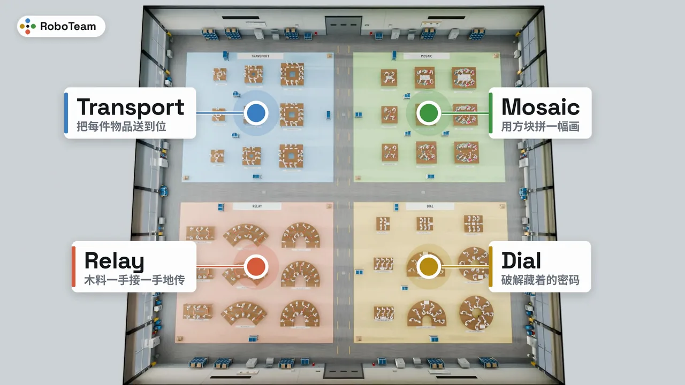
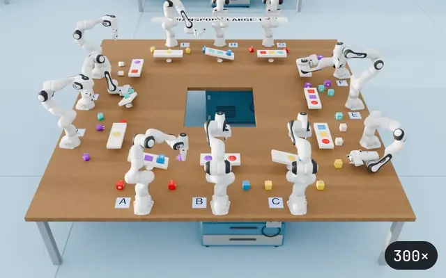
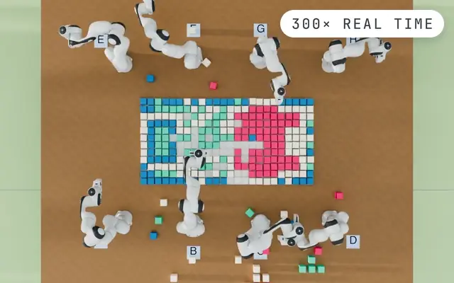
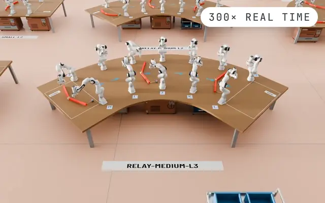
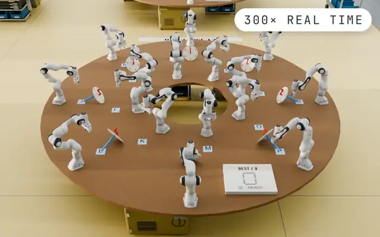
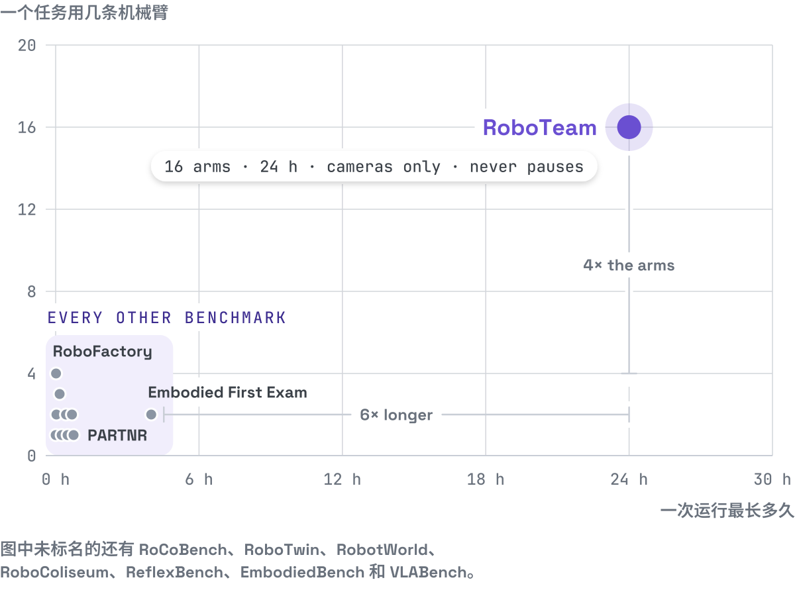
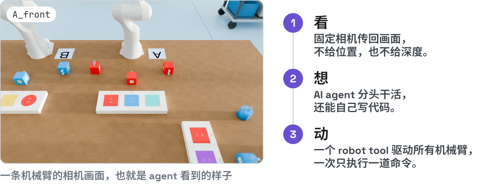
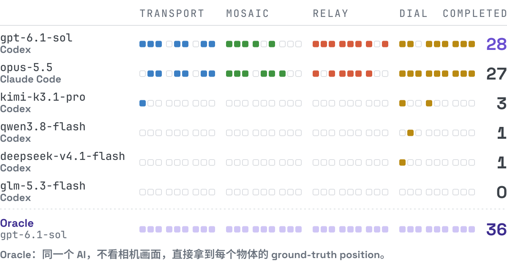
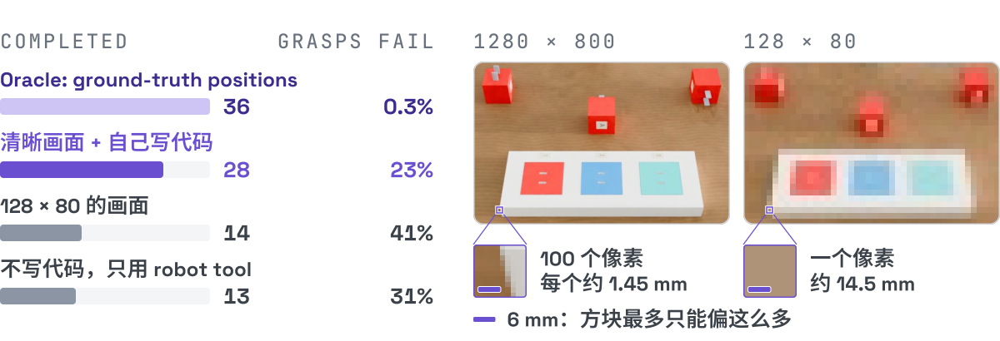
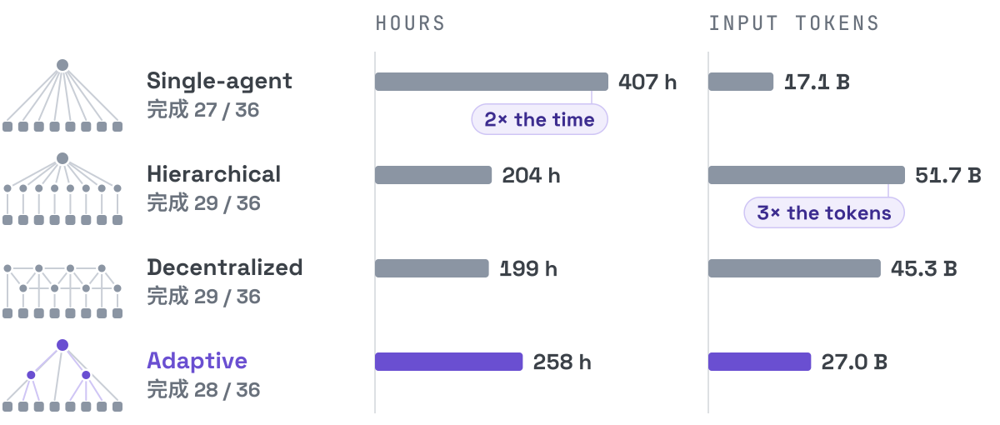

<div align="center">

<h1>
<a href="https://changxuanfan.github.io/RoboTeam/zh/">
<picture>
<source media="(prefers-color-scheme: dark)" srcset="docs/media/readme/wordmark-dark.svg">

</picture>
</a>
</h1>

<h3>RoboTeam: Benchmarking Vision-Based Multi-Agent Control<br>of Many Robot Arms in Real Time</h3>

<p><i>AI agent 团队只看相机画面，实时操控满厂房的机械臂。</i></p>

<a href="https://arxiv.org/abs/2611.22138"><picture><source media="(prefers-color-scheme: dark)" srcset="docs/media/readme/button-paper-dark.zh-CN.svg"></picture></a>&nbsp;
<a href="https://changxuanfan.github.io/RoboTeam/zh/"><picture><source media="(prefers-color-scheme: dark)" srcset="docs/media/readme/button-page-dark.zh-CN.svg"></picture></a>&nbsp;
<a href="https://huggingface.co/datasets/RoboTeam-Bench/RoboTeam-Videos"><picture><source media="(prefers-color-scheme: dark)" srcset="docs/media/readme/button-videos-dark.zh-CN.svg"></picture></a>&nbsp;
<a href="#license"><picture><source media="(prefers-color-scheme: dark)" srcset="docs/media/readme/button-license-dark.zh-CN.svg"></picture></a>

[English](README.md) | 简体中文

[四类任务](#the-four-jobs) · [看录像](#watch-whole-runs) · [怎么运行](#how-a-run-works) · [发现](#what-we-found) · [快速上手](#quick-start) · [文档](docs/zh-CN/README.md)

<picture>
<source media="(prefers-reduced-motion: reduce)" srcset="docs/media/readme/hero.zh-CN.webp">
<source type="image/avif" srcset="docs/media/readme/hero.zh-CN.avif">

</picture>

<picture>
<source media="(max-width: 600px) and (prefers-color-scheme: dark)" srcset="docs/media/readme/numbers-phone-dark.zh-CN.svg">
<source media="(max-width: 600px)" srcset="docs/media/readme/numbers-phone-light.zh-CN.svg">
<source media="(prefers-color-scheme: dark)" srcset="docs/media/readme/numbers-dark.zh-CN.svg">

</picture>

</div>

<a id="what-roboteam-is"></a>
## RoboTeam 是什么

RoboTeam 是一座仿真厂房：一队 AI agent 只能透过相机看世界，操控 4 到 16 条机械臂干活。这里有四类任务，每类分三种团队规模、三个难度，一共 36 个任务。它统计三件事：一个团队完成了多少任务，花了多久，用了多少 input tokens。input tokens 是模型读进去的文字量，直接决定成本。

<a id="the-four-jobs"></a>
## 四类任务

<table><tr>
<td width="50%" valign="top"><a href="https://changxuanfan.github.io/RoboTeam/zh/#task=transport-large-l3&amp;set=gpt-6.1-sol"></a><br><b>Transport</b><br>把每件物品送到它该去的板上，中途在机械臂之间接力传递。<br><sub>4–12 条机械臂 · flat → sockets → sprung</sub></td>
<td width="50%" valign="top"><a href="https://changxuanfan.github.io/RoboTeam/zh/#task=mosaic-large-l1&amp;set=opus-5.5"></a><br><b>Mosaic</b><br>用彩色方块拼出一幅画，每格一块。<br><sub>4–8 条机械臂 · pockets → lines → no grid</sub></td>
</tr></table>
<table><tr>
<td width="50%" valign="top"><a href="https://changxuanfan.github.io/RoboTeam/zh/#task=relay-medium-l3&amp;set=gpt-6.1-sol"></a><br><b>Relay</b><br>抬长木料：一根得两条机械臂合力抬，还要在半空中换手。<br><sub>8–16 条机械臂 · straight → curved → hinged</sub></td>
<td width="50%" valign="top"><a href="https://changxuanfan.github.io/RoboTeam/zh/#task=dial-large-l3&amp;set=gpt-6.1-sol"></a><br><b>Dial</b><br>拧带弹簧的旋钮，试出藏着的密码，再把所有旋钮同时稳住。<br><sub>4–16 条机械臂 · table → lifted → crank</sub></td>
</tr></table>

点开任意一段，都能在项目网页上看这次运行的完整录像。36 个任务的全貌见[任务说明](docs/zh-CN/tasks/README.md)。

<a id="watch-whole-runs"></a>
## 看完整录像

下面是完整运行的录像，10× real time 播放，静止的片段已剪掉。每个模型的全部运行、三个机位的录像，都在[项目网页](https://changxuanfan.github.io/RoboTeam/zh/#videos)上。

<table><tr>
<td width="50%" valign="top"><video src="https://github.com/user-attachments/assets/85ab5c04-a60b-4e3f-b364-105a6b39f723" controls muted width="100%"></video><!-- video:transport-1 --><br><sub><b>Transport</b> · opus-5.5 · 12 条机械臂，物品要插进插槽 · 10×，11:20</sub></td>
<td width="50%" valign="top"><video src="https://github.com/user-attachments/assets/804f16ac-984b-4a7b-98ef-41f686ad29ca" controls muted width="100%"></video><!-- video:mosaic-1 --><br><sub><b>Mosaic</b> · opus-5.5 · 6 条机械臂，162 个方块，桌上没有网格 · 10×，8:56</sub></td>
</tr></table>
<table><tr>
<td width="50%" valign="top"><video src="https://github.com/user-attachments/assets/de8afa7e-a1fb-46e8-9eb6-75f3715b8780" controls muted width="100%"></video><!-- video:relay-2 --><br><sub><b>Relay</b> · opus-5.5 · 12 条机械臂，弧形木料下吊着重物 · 10×，3:51</sub></td>
<td width="50%" valign="top"><video src="https://github.com/user-attachments/assets/b61e48bd-bd4d-4192-b86e-6c07c43f6ab8" controls muted width="100%"></video><!-- video:dial-1 --><br><sub><b>Dial</b> · gpt-6.1-sol · 16 条机械臂，8 个曲柄要托在半空 · 10×，4:31</sub></td>
</tr></table>

<details>
<summary><b>再看四段</b></summary>

&nbsp;

<table><tr>
<td width="50%" valign="top"><video src="https://github.com/user-attachments/assets/06263096-6cc7-4c47-96ba-8815f376f2f5" controls muted width="100%"></video><!-- video:transport-2 --><br><sub><b>Transport</b> · gpt-6.1-sol · 8 条机械臂，物品要插进插槽 · 10×，9:02</sub></td>
<td width="50%" valign="top"><video src="https://github.com/user-attachments/assets/edf6dfaf-4797-4478-b983-82612114b3a5" controls muted width="100%"></video><!-- video:mosaic-2 --><br><sub><b>Mosaic</b> · gpt-6.1-sol · 4 条机械臂，72 个方块，桌上没有网格 · 10×，5:55</sub></td>
</tr></table>
<table><tr>
<td width="50%" valign="top"><video src="https://github.com/user-attachments/assets/c3e1f49b-aec6-4eaa-abc4-3014f60ad030" controls muted width="100%"></video><!-- video:relay-1 --><br><sub><b>Relay</b> · gpt-6.1-sol · 16 条机械臂，直木料 · 10×，2:14</sub></td>
<td width="50%" valign="top"><video src="https://github.com/user-attachments/assets/6b6cfcf8-25e7-4227-8b83-9539a6f82f1d" controls muted width="100%"></video><!-- video:dial-2 --><br><sub><b>Dial</b> · opus-5.5 · 12 条机械臂，6 个曲柄要托在半空 · 10×，1:46</sub></td>
</tr></table>

</details>

所有录像文件都在 Hugging Face 上的 [RoboTeam-Videos 数据集](https://huggingface.co/datasets/RoboTeam-Bench/RoboTeam-Videos)里，少数几次运行标着 Coming soon。

<a id="what-is-new"></a>
## 新在哪里

以往的 benchmark 在三个地方把世界做简单了，RoboTeam 把这三样都拿掉了：

- **机械臂多，任务长。** 多数 benchmark 只用一两条机械臂，任务几分钟就结束。RoboTeam 参照真实的多机器人作业，一个任务用 4 到 16 条机械臂，一次运行最长 24 小时。
- **世界从不暂停。** 很多仿真器会在 agent 思考时停下来。RoboTeam 的时钟一直在走，想得慢就是在耗工时。
- **只有相机。** 很多 benchmark 会直接告诉 agent 每个物体在哪。RoboTeam 和真实机器人一样，位置得靠 agent 从画面里自己看出来。

<p align="center"><b>16 条机械臂、单次最长 24 小时，只有 RoboTeam 做到了。</b><br><sub>另外十个 benchmark 的数据取自论文里的对比表</sub></p>

<p align="center"><a href="https://changxuanfan.github.io/RoboTeam/zh/#new">
<picture>
<source media="(prefers-color-scheme: dark)" srcset="docs/media/readme/compare-dark.zh-CN.svg">

</picture>
</a></p>

<a id="how-a-run-works"></a>
## 一次运行怎么跑

<a href="https://changxuanfan.github.io/RoboTeam/zh/#how">
<picture>
<source media="(prefers-color-scheme: dark)" srcset="docs/media/readme/how-dark.zh-CN.svg">

</picture>
</a>

时钟从不停：agent 宣布完成，或者干满 24 小时，运行才结束。每个团队用四种 agent system 之一：single-agent、hierarchical、decentralized，或者默认的 adaptive。细节见[运行规则](docs/zh-CN/benchmark/rules.md#a-run-in-six-steps)。

<a id="what-we-found"></a>
## 我们的发现

gpt-6.1-sol 完成了 36 个任务中的 28 个，opus-5.5 完成了 27 个，其余四个模型最多完成 3 个。在 Oracle 条件下，同一个 gpt-6.1-sol 不看相机画面，直接拿到每个物体的 ground-truth position，36 个任务全部完成。

<a id="1--two-models-complete-most-of-the-36-tasks"></a>
### 1 · 36 个任务，两个模型完成了大部分

<sub>每格一个任务，实心表示完成。只看相机画面。</sub>

<p align="center"><a href="https://changxuanfan.github.io/RoboTeam/zh/#results">
<picture>
<source media="(prefers-color-scheme: dark)" srcset="docs/media/readme/board-dark.zh-CN.svg">

</picture>
</a></p>

<a id="2--seeing-is-the-hard-part"></a>
### 2 · 难就难在看

只看相机画面时，gpt-6.1-sol 的抓取有 23% 会失败；直接给出所有位置时，失败率只有 0.3%。画面缩到 128 × 80 像素，或者不让它自己写代码来量，完成的任务就从 28 个掉到 14 个和 13 个。

<p align="center"><a href="https://changxuanfan.github.io/RoboTeam/zh/#f-vision">
<picture>
<source media="(prefers-color-scheme: dark)" srcset="docs/media/readme/vision-dark.zh-CN.svg">

</picture>
</a></p>

<a id="3--same-score-very-different-bill"></a>
### 3 · 分数差不多，账单差很多

gpt-6.1-sol 的四种 agent system 都完成了 27 到 29 个任务。可跑完全部 36 个任务，hierarchical system 用的 input tokens 是 single-agent system 的 3 倍，single-agent system 花的时间又是 decentralized system 的 2 倍。图里的小时数和 input tokens 都是 36 个任务的总和。

<p align="center"><a href="https://changxuanfan.github.io/RoboTeam/zh/#f-systems">
<picture>
<source media="(prefers-color-scheme: dark)" srcset="docs/media/readme/systems-dark.zh-CN.svg">

</picture>
</a></p>

<a id="more-findings"></a>
### 更多发现

每一条在项目网页上都有对应的图：

- [机械臂大部分时间在干等。](https://changxuanfan.github.io/RoboTeam/zh/#f-time)在一次有完整记录的运行里，90% 的时间里至少有一个 agent 在思考，而至少有一条机械臂在动的时间只有 43%。
- [失败了就再来，再正常不过。](https://changxuanfan.github.io/RoboTeam/zh/#f-failure)gpt-6.1-sol 跑典型的 Relay 任务时，每一步都至少失败过一次，可 9 个 Relay 任务它还是完成了 8 个。
- [团队变大，比难度升级更难对付。](https://changxuanfan.github.io/RoboTeam/zh/#f-levels)按难度分，每档 12 个任务，gpt-6.1-sol 分别完成 9、9、10 个；按团队规模分，则是 11、10、7 个。

花得多不等于做得成：deepseek-v4.1-flash 用了 25.0 B input tokens，只完成 1 个任务；gpt-6.1-sol 用了 27.0 B，完成了 28 个。目前还没有哪个模型或 agent system 能同时做到快、省、稳。所有图表和每次运行的录像都在[项目网页的结果页](https://changxuanfan.github.io/RoboTeam/zh/#results)，全部实验条件和数字见[论文](https://arxiv.org/abs/2611.22138)。

<a id="quick-start"></a>
## 快速上手

```sh
git clone https://github.com/changxuanfan/RoboTeam.git && cd RoboTeam
uv sync --locked                                   # Python 3.12 and the locked packages
.venv/bin/roboteam bootstrap                       # the task assets, checked by hash
.venv/bin/roboteam plan --task-types relay --level 1
```

`plan` 只列出一个 batch 会跑哪些任务，不调用任何模型，适合当第一条命令。真正跑一次运行，还需要一个模型账号、固定版本的 Codex 或 Claude Code 命令行程序，以及给 agent 用的沙箱 Python 环境。[上手指南](docs/zh-CN/getting-started.md)从刚克隆的仓库讲起，一步步讲到跑完一次完整运行。

<a id="documentation"></a>
## 文档

- [上手指南](docs/zh-CN/getting-started.md)和[命令行](docs/zh-CN/cli.md)
- [任务说明](docs/zh-CN/tasks/README.md)和[运行规则](docs/zh-CN/benchmark/rules.md)
- [Harness 和模型](docs/zh-CN/harness/README.md)：Codex、Claude Code，以及各自能跑的模型
- 主机：[Mac](docs/zh-CN/hosts/mac.md)、[Linux](docs/zh-CN/hosts/linux.md)、[Docker](docs/zh-CN/hosts/docker.md) 和 [Slurm](docs/zh-CN/hosts/slurm.md)
- [仓库结构](docs/zh-CN/development/repository-layout.md)：每个文件夹放什么
- [全部文档](docs/zh-CN/README.md)和[贡献指南](.github/CONTRIBUTING.md)（英文）

<a id="citation"></a>
## 引用

```bibtex
@article{fan2026roboteam,
  title   = {RoboTeam: Benchmarking Vision-Based Multi-Agent Control of
             Many Robot Arms in Real Time},
  author  = {Fan, Changxuan and Xie, Zhongwei and Zhang, Boyi and Hu, Shaoli and
             Xu, Chang and Ren, Xiyu and Li, Yufei and Xiao, Qiao and Jing, Huihao and
             Chung, Kawai and Hu, Wenbin and Luo, Hongyu and Xie, Lingyun and
             Gao, Yisen and Li, Chunyang and Huang, Haoyu and Song, Wuganjing and
             Liu, Yuxuan and Tang, Chiu Yeung and Zhan, Fangneng and Yang, Xi},
  journal = {arXiv preprint arXiv:2611.22138},
  year    = {2026},
  url     = {https://arxiv.org/abs/2611.22138}
}
```

[`CITATION.cff`](CITATION.cff) 里是同一条记录。

<a id="license"></a>
## 许可

代码采用 [MIT 许可](LICENSE)。benchmark 的数据和媒体采用 [CC BY 4.0](LICENSE-DATA.md)；其中也列出了沿用各自许可的第三方素材。中文版以英文版为准。
