[English](../../tasks/README.md) | 简体中文
> 本文译自英文版（commit 2b16d5ce），内容以英文版为准。

# 任务

任务类型共四种，每种分三档团队规模（`small`、`medium`、`large`）和三个难度（`l1` 到 `l3`），合起来是 36 个任务，按 `<task type>-<team size>-l<level>` 命名，例如 `transport-small-l1` 和 `dial-large-l3`。团队规模越大，机械臂越多，要分的活也越多。难度越高，同样的活在物理上或视觉上越难做。代码和文件名里，任务也叫 *case*。

发布清单 [`benchmark/release.json`](../../../benchmark/release.json) 按哈希记下每个 case 的场景、公开任务和任务材料。每个 case 放在 `benchmark/<task type>/<case>/` 下，一种任务类型有哪些 case，列在 `benchmark/<task type>/catalog.json` 里（见[发布的文件](../../../benchmark/README.md)）。

| 任务类型 | Case | 团队要做什么 | Level 1 → 3 | 说明 |
| --- | --- | --- | --- | --- |
| Transport | `transport-small/medium/large-l1..l3`（4、8、12 条机械臂；12、24、36 件物品） | 把每件指定的方块或圆柱送到目标板上的对应位置 | 放到板上就行 → 两片插片插进固定的盲槽 → 同样的槽，但板装在弹簧上 | [Transport](transport.md) |
| Mosaic | `mosaic-small/medium/large-l1..l3`（4、6、8 条机械臂；6×12、9×18、12×24 = 72、162、288 格） | 拼出四色 Tulip 图案，每格一块方块 | 70 mm 凹槽 → 印刷的网格线 → 看不见网格 | [Mosaic](mosaic.md) |
| Relay | `relay-small/medium/large-l1..l3`（8、12、16 条机械臂；2、3、4 根木料） | 把长木料运到 GOAL，每根至少在空中交接一次 | 直木料 → 下面吊着重物的弧形木料 → 带弹簧的折角木料，同样吊着重物 | [Relay](relay.md) |
| Dial | `dial-small/medium/large-l1..l3`（4、6、8 个拨盘；Level 1 用 4、6、8 条机械臂，Level 2 和 3 翻倍） | 试出密码，并让所有拨盘同时停在密码上；唯一的反馈是 BEST，即到目前为止的最好成绩 | 固定的齿轮拨盘 → 每个模块由另一条机械臂托在空中 → 同上，再加曲柄 | [Dial](dial.md) |

## 全部 36 个任务

每张图都是一个任务开始时的样子。点开图片，可以在[项目网页](https://changxuanfan.github.io/RoboTeam/zh/)上看这个任务的各次运行。

<b>Transport</b>

<table><tr><th></th><th>4 条机械臂</th><th>8 条机械臂</th><th>12 条机械臂</th></tr><tr><th>L1</th><td><a href="https://changxuanfan.github.io/RoboTeam/zh/#task=transport-small-l1">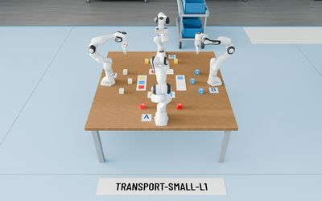</a> transport-small-l1</td><td><a href="https://changxuanfan.github.io/RoboTeam/zh/#task=transport-medium-l1">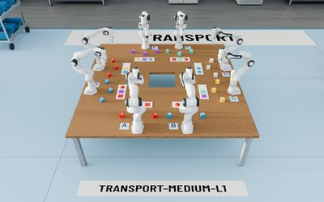</a> transport-medium-l1</td><td><a href="https://changxuanfan.github.io/RoboTeam/zh/#task=transport-large-l1">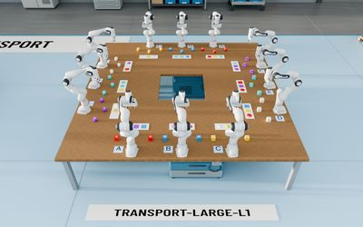</a> transport-large-l1</td></tr><tr><th>L2</th><td><a href="https://changxuanfan.github.io/RoboTeam/zh/#task=transport-small-l2">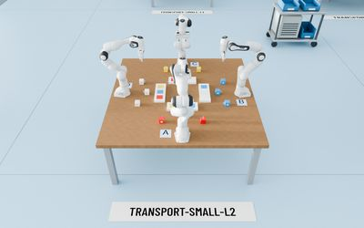</a> transport-small-l2</td><td><a href="https://changxuanfan.github.io/RoboTeam/zh/#task=transport-medium-l2">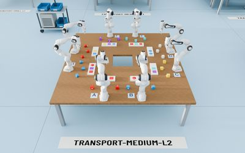</a> transport-medium-l2</td><td><a href="https://changxuanfan.github.io/RoboTeam/zh/#task=transport-large-l2">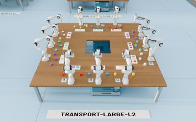</a> transport-large-l2</td></tr><tr><th>L3</th><td><a href="https://changxuanfan.github.io/RoboTeam/zh/#task=transport-small-l3">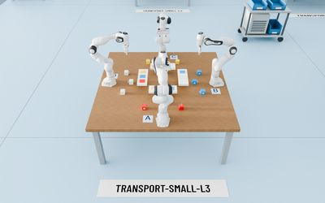</a> transport-small-l3</td><td><a href="https://changxuanfan.github.io/RoboTeam/zh/#task=transport-medium-l3">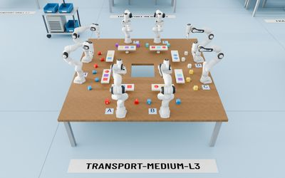</a> transport-medium-l3</td><td><a href="https://changxuanfan.github.io/RoboTeam/zh/#task=transport-large-l3">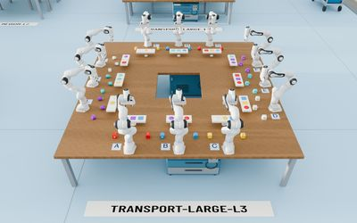</a> transport-large-l3</td></tr></table>

<b>Mosaic</b>

<table><tr><th></th><th>4 条机械臂</th><th>6 条机械臂</th><th>8 条机械臂</th></tr><tr><th>L1</th><td><a href="https://changxuanfan.github.io/RoboTeam/zh/#task=mosaic-small-l1">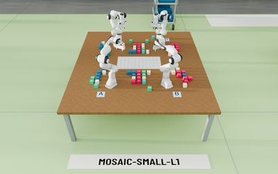</a> mosaic-small-l1</td><td><a href="https://changxuanfan.github.io/RoboTeam/zh/#task=mosaic-medium-l1">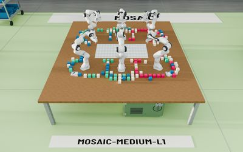</a> mosaic-medium-l1</td><td><a href="https://changxuanfan.github.io/RoboTeam/zh/#task=mosaic-large-l1">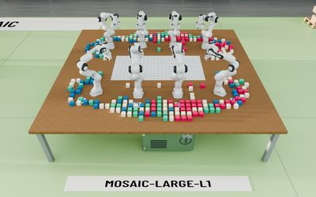</a> mosaic-large-l1</td></tr><tr><th>L2</th><td><a href="https://changxuanfan.github.io/RoboTeam/zh/#task=mosaic-small-l2">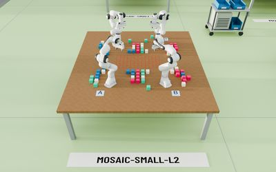</a> mosaic-small-l2</td><td><a href="https://changxuanfan.github.io/RoboTeam/zh/#task=mosaic-medium-l2">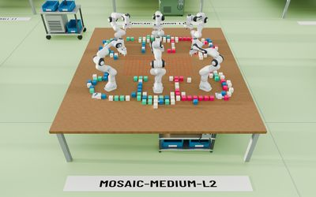</a> mosaic-medium-l2</td><td><a href="https://changxuanfan.github.io/RoboTeam/zh/#task=mosaic-large-l2">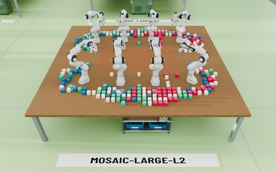</a> mosaic-large-l2</td></tr><tr><th>L3</th><td><a href="https://changxuanfan.github.io/RoboTeam/zh/#task=mosaic-small-l3">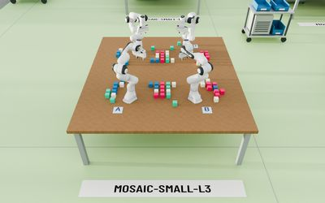</a> mosaic-small-l3</td><td><a href="https://changxuanfan.github.io/RoboTeam/zh/#task=mosaic-medium-l3">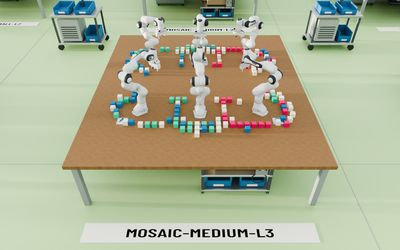</a> mosaic-medium-l3</td><td><a href="https://changxuanfan.github.io/RoboTeam/zh/#task=mosaic-large-l3">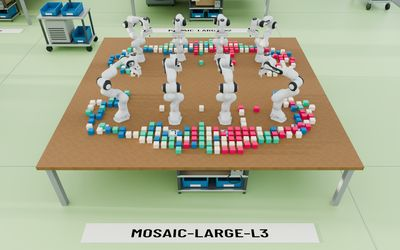</a> mosaic-large-l3</td></tr></table>

<b>Relay</b>

<table><tr><th></th><th>8 条机械臂</th><th>12 条机械臂</th><th>16 条机械臂</th></tr><tr><th>L1</th><td><a href="https://changxuanfan.github.io/RoboTeam/zh/#task=relay-small-l1">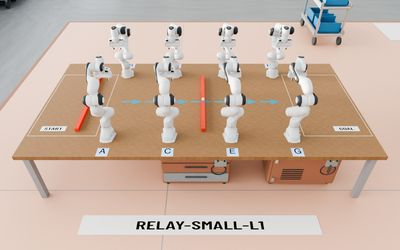</a> relay-small-l1</td><td><a href="https://changxuanfan.github.io/RoboTeam/zh/#task=relay-medium-l1">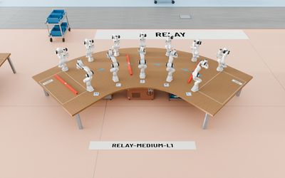</a> relay-medium-l1</td><td><a href="https://changxuanfan.github.io/RoboTeam/zh/#task=relay-large-l1">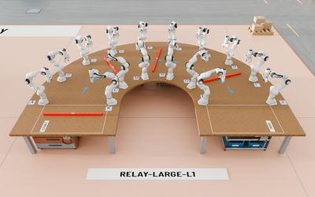</a> relay-large-l1</td></tr><tr><th>L2</th><td><a href="https://changxuanfan.github.io/RoboTeam/zh/#task=relay-small-l2">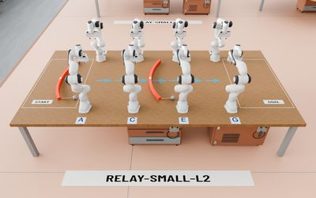</a> relay-small-l2</td><td><a href="https://changxuanfan.github.io/RoboTeam/zh/#task=relay-medium-l2">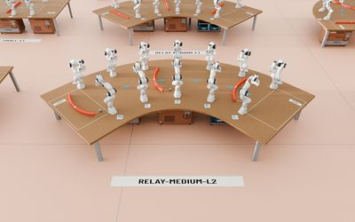</a> relay-medium-l2</td><td><a href="https://changxuanfan.github.io/RoboTeam/zh/#task=relay-large-l2">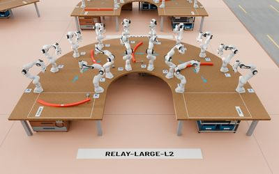</a> relay-large-l2</td></tr><tr><th>L3</th><td><a href="https://changxuanfan.github.io/RoboTeam/zh/#task=relay-small-l3">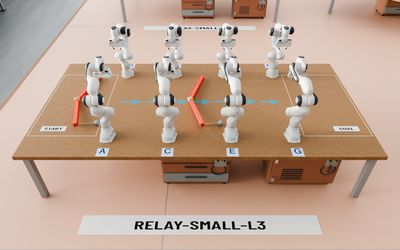</a> relay-small-l3</td><td><a href="https://changxuanfan.github.io/RoboTeam/zh/#task=relay-medium-l3">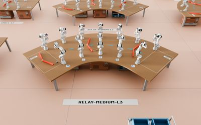</a> relay-medium-l3</td><td><a href="https://changxuanfan.github.io/RoboTeam/zh/#task=relay-large-l3">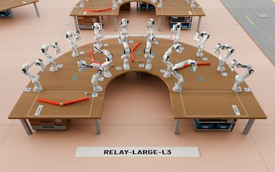</a> relay-large-l3</td></tr></table>

<b>Dial</b>

<table><tr><th></th><th>4 个拨盘</th><th>6 个拨盘</th><th>8 个拨盘</th></tr><tr><th>L1</th><td><a href="https://changxuanfan.github.io/RoboTeam/zh/#task=dial-small-l1">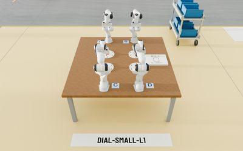</a> dial-small-l1</td><td><a href="https://changxuanfan.github.io/RoboTeam/zh/#task=dial-medium-l1">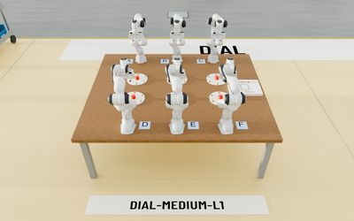</a> dial-medium-l1</td><td><a href="https://changxuanfan.github.io/RoboTeam/zh/#task=dial-large-l1">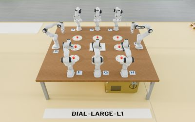</a> dial-large-l1</td></tr><tr><th>L2</th><td><a href="https://changxuanfan.github.io/RoboTeam/zh/#task=dial-small-l2">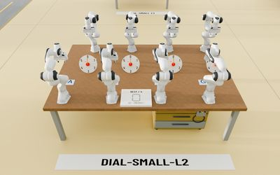</a> dial-small-l2</td><td><a href="https://changxuanfan.github.io/RoboTeam/zh/#task=dial-medium-l2">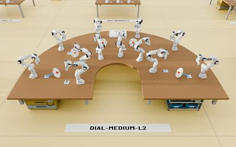</a> dial-medium-l2</td><td><a href="https://changxuanfan.github.io/RoboTeam/zh/#task=dial-large-l2">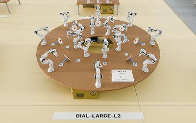</a> dial-large-l2</td></tr><tr><th>L3</th><td><a href="https://changxuanfan.github.io/RoboTeam/zh/#task=dial-small-l3">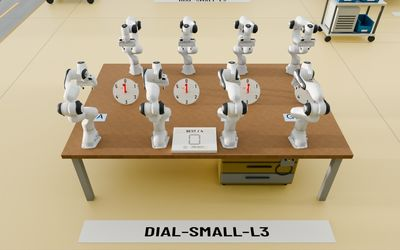</a> dial-small-l3</td><td><a href="https://changxuanfan.github.io/RoboTeam/zh/#task=dial-medium-l3">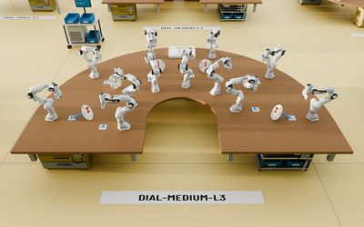</a> dial-medium-l3</td><td><a href="https://changxuanfan.github.io/RoboTeam/zh/#task=dial-large-l3">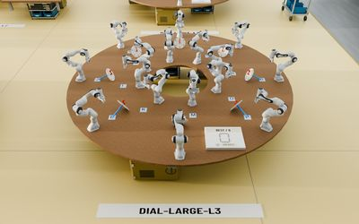</a> dial-large-l3</td></tr></table>

## 所有任务的共同点

- **agent 能看到什么。** 开跑前，agent 拿到这个 case 的公开任务（`public/task.json`：规则、目标、相机和安装位置、初始几何、库存、订单或目标、完成规则），`public/inputs/task/` 里的任务材料（Mosaic 的目标图像；Dial 的预览图、相机标定和桌面几何），以及任务指南（`prompts/guides/<task type>.md`）。运行中，agent 想看哪台相机就请求哪台，拿到的是带时间戳的 RGB 图像；另外还能拿到自己机械臂的状态（关节角、手部位姿、夹爪开口）和每个动作的结果。场景文件、评分程序和物体的状态，agent 一概看不到。打开 [ground-truth observation](../benchmark/rules.md#ground-truth-observation) 设置后，agent 拿到的不再是图像，而是仿真器的状态。
- **在哪里做。** 所有任务都在同一座厂房里，每个任务占一张工作台。厂房和其余 35 个任务的工作台都会出现在图像里，但它们一动不动，也不和任何东西碰撞。
- **物理。** 发布版的物理设置写在每个场景文件里。每个动作都要给出速度、加速度或力，而且不能超过真实 Franka Panda 的限值（[物理](../../benchmark/physics.md)）。只有机器人的执行器和真实的接触能改变仿真世界：不重置，不加焊接约束，也不直接改写状态。
- **时间。** 从 START 起算，有效时间 24 小时。服务中断、触到用量上限的暂停和主机休眠都不算在内：基础设施暂停一次运行时，仿真世界、时钟和 agent 一起停下。agent 不知道有这个上限（[时间和暂停](../../runs/time.md)）。
- **评分。** 团队调用 `finish` 时，或者到了 24 小时上限时，先停下所有机械臂，让仿真世界在机械臂不动的情况下再跑 1.5 秒，然后评分。分数就是终局结果（`terminal_outcome_v2`）。碰撞、掉落等过程事件另外记下，不会推翻这个结果。Relay 的交接规则是它完成条件的一部分（[终局结果](../benchmark/rules.md#terminal-outcome)）。
- **续跑。** 停下的运行续跑时仍是同一个 trial，不算重新尝试（[续跑停下的运行](../../runs/continuation.md)）。

## 相机

所有相机都固定在仿真世界里。一个任务有 14 到 69 台相机：每条机械臂旁两台，四台全局相机，另有几台特写相机，具体看任务类型。

| 分组 | 名称 | 拍什么 |
| --- | --- | --- |
| 机械臂旁 | `A_front`、`A_side`、… | 每条机械臂两台：一台拍机械臂前方的桌面，一台从侧面拍机械臂 |
| 全局 | `global`、`global_side`、`global_rear`、`top` | 从正面和侧面拍整张工作台；`global_rear` 是 `global` 绕桌面中心转半圈；`top` 垂直向下拍 |
| Transport 特写 | `board_A_close`、…；Level 2 起还有 `plug_close`、`socket_close` | 每块目标板一台；另外各挑一处，拍一件物品的插片和一块板上的盲槽 |
| Mosaic 特写 | `assembly_01`、… | 拼装区，分成两到四块来拍 |
| Relay 特写 | `payload_close`、`payload_01_close`、…；Level 2 起还有 `payload_01_weight_close`、…；Level 3 还有 `payload_01_hinge_close`、… | 起始区，以及每根木料的起始位置；每个吊着的重物和每个铰链的起始位置 |
| Dial 特写 | `D01_front`、`D01_side`、`D01_high`、`D01_face`、…；`board` | 每个拨盘四台：正面、侧面、上方，以及正对盘面垂直向下；还有一台拍 BEST 显示屏 |

| 任务类型 | Small | Medium | Large |
| --- | --- | --- | --- |
| Transport（Level 1 / Level 2 和 3） | 16 / 18 | 28 / 30 | 40 / 42 |
| Mosaic | 14 | 19 | 24 |
| Relay（Level 1 / Level 2 / Level 3） | 23 / 25 / 27 | 32 / 35 / 38 | 41 / 45 / 49 |
| Dial（Level 1 / Level 2 和 3） | 29 / 37 | 41 / 53 | 53 / 69 |

相机不会跟着任何东西走：木料一旦搬走，它的特写相机拍到的就只剩空桌面。任务开始时，每台相机的画面里，机器人挡住的部分都不超过 40%。

## 指标

agent 可以重试，所以最后做对的任务，中间也可能失败过很多次。除了结果，还要看一次运行里步骤和抓取多常失败，以及花了多少时间和 input tokens。input tokens 是模型读入的文字量，决定成本。

- **完成。** 最终状态正确，任务就算完成。分别数一数 3、6、12、24 小时内完成了几个任务，就能看出一个条件做得有多快。
- **Atomic failure rate。** 原子步骤（atomic step）是最小的进度单位：Mosaic 里是把一块方块放到它的格子上，Transport 里是把一件物品送到目标位置或交给另一条机械臂，Relay 里是一条机械臂在交接中抓住木料，Dial 里是把一个旋钮拧到新位置。一个步骤只要有一次尝试出了错，就算失败，后来做成了也一样。一次运行的 atomic failure rate，就是至少失败过一次的步骤占全部步骤的比例。失败从 robot tool 和仿真器的记录里读出，从不采信 agent 自己的汇报（`roboteam/analysis/atomic.py`、`scripts/analysis/run_analysis.py`）。
- **抓取失败率。** 抓取命令会写明预期的宽度。夹爪合拢后如果停在这个宽度之外，说明夹到的宽度和物体对不上，这次抓取就算失败。一个条件的抓取失败率，是它所有抓取里失败的比例。
- **配对检验。** 每个条件跑的都是同一批任务，所以两个条件可以逐个任务对比，方法是精确 McNemar 检验、Holm 校正和 bootstrap 区间（`roboteam/analysis/paired.py`、`scripts/analysis/paired_tests.py`）。
